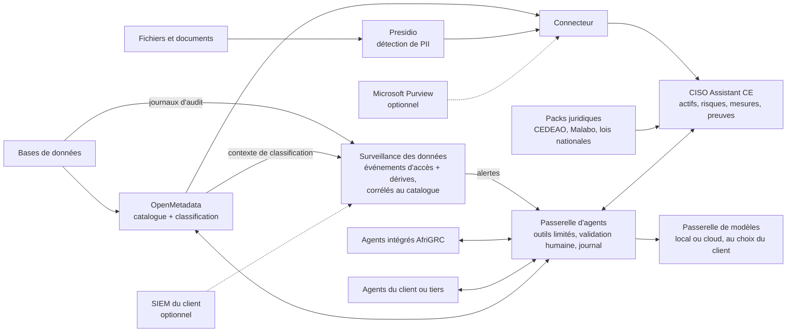

# AfriGRC (nom de travail)

**Plateforme 100 % open source et souveraine de sécurité des données et de GRC (gouvernance, risques et conformité), conçue pour le cadre juridique ouest-africain, avec des agents IA encadrés et interchangeables.**

🇬🇧 [Read in English](README.md)

> 🚧 **Statut du projet : stade précoce (concept, architecture, premières briques).**
> Il n'existe pas encore de prototype fonctionnel de la plateforme. Ce qui existe aujourd'hui : la vision, l'architecture, la feuille de route, un générateur de jeu de données fictif et une base de démo auditée pour la preuve de concept (voir [`data/synthetic`](data/synthetic) et [`deploy`](deploy)). La preuve de concept locale est l'étape en cours (voir [Feuille de route](#feuille-de-route)).

---

## Le problème

Les PME, administrations et écoles d'Afrique de l'Ouest doivent protéger les données personnelles et gérer leurs risques cyber. Elles sont soumises à des lois nationales (loi sénégalaise sur les données personnelles, loi ivoirienne, Nigeria Data Protection Act, loi ghanéenne, etc.), à l'Acte additionnel A/SA.1/01/10 de la CEDEAO et, de plus en plus, à la Convention de Malabo de l'Union africaine.

Pourtant, les outils qui rendent cela réalisable sont hors de portée :

- Les suites de gouvernance des données et plateformes GRC commerciales (comme Microsoft Purview) coûtent cher, sont souvent liées à un écosystème propriétaire et supposent un tenant éditeur précis.
- Elles sont conçues autour de référentiels européens ou américains, rarement autour des lois, des langues, des identifiants et des budgets de la région.
- Les référentiels ouest-africains sont dispersés : chaque pays a son texte, son autorité et son calendrier, alors que beaucoup d'organisations opèrent dans plusieurs pays.

Résultat : la conformité se fait à la main, par des missions de conseil longues et coûteuses, ou ne se fait pas.

## La solution

AfriGRC repose sur deux priorités : la **GRC** (actifs, risques, mesures, preuves, audits face aux lois locales) et la **sécurité des données** (savoir où se trouvent les données sensibles, qui y touche et quand quelque chose dérive). Elle assemble des briques open source matures en une plateforme qui tourne sur l'infrastructure du client, sans dépendance à un éditeur. Elle fonctionne seule, et peut optionnellement se coupler à Microsoft Purview ou au SIEM du client.

| Couche | Composant | Rôle |
|---|---|---|
| Gouvernance, risques et conformité | [CISO Assistant](https://github.com/intuitem/ciso-assistant-community) (Community Edition) | Actifs, risques, mesures, preuves, audits, référentiels de conformité |
| Découverte et classification des données | [OpenMetadata](https://open-metadata.org/) | Catalogue de données, lineage, détection et étiquetage automatiques des données personnelles (PII) sur les données structurées |
| Analyse des données non structurées | [Microsoft Presidio](https://github.com/microsoft/presidio) (projet open source) | Détection de PII dans les documents et textes, étendue avec des reconnaisseurs français, anglais et locaux |
| Surveillance de la sécurité des données | Module maison (ce dépôt) alimenté par les journaux d'audit natifs des bases (par exemple pgaudit pour PostgreSQL) | Détecte les accès aux données sensibles et les dérives de classification, et relie chaque événement au catalogue et aux obligations légales |
| Intégration | Connecteur maison (ce dépôt) | Transforme les résultats de découverte en actifs, risques et preuves dans CISO Assistant |
| Passerelle d'agents | Service maison (ce dépôt) | Point d'accès unique et contrôlé pour tous les agents IA : outils limités, validation humaine, journal d'audit |
| Passerelle de modèles | Proxy indépendant du modèle, comme [LiteLLM](https://github.com/BerriAI/litellm) (à valider) | Permet au client de choisir des modèles de langage locaux ou cloud via une seule interface |
| Intelligence | Agents IA encadrés (ce dépôt) et agents fournis par le client | Automatisent les tâches répétitives et coûteuses d'une mission de conformité |
| Intégrations optionnelles | Microsoft Purview ; le SIEM du client (par exemple Wazuh) | Import des résultats de classification de Purview ; réception des alertes d'infrastructure d'un SIEM existant |

## Cadre juridique ciblé

Le cœur de la valeur d'AfriGRC est un ensemble de **« packs juridiques »** : des référentiels personnalisés CISO Assistant, un par texte, que l'on peut combiner pour une organisation multi-pays. Une même évaluation peut être confrontée à plusieurs référentiels à la fois.

| Niveau | Textes visés |
|---|---|
| Régional | Acte additionnel A/SA.1/01/10 de la CEDEAO sur la protection des données personnelles (en cours de révision) ; Acte additionnel A/SA.2/01/10 sur les transactions électroniques ; Directive 1/08/11 sur la cybercriminalité |
| Continental | Convention de Malabo de l'Union africaine (entrée en vigueur le 8 juin 2023) |
| National, priorité 1 | Sénégal : loi n° 2008-12 sur la protection des données à caractère personnel |
| National, priorité 2 | Côte d'Ivoire (loi n° 2013-450), Nigeria (Nigeria Data Protection Act 2023 et GAID), Ghana (Data Protection Act 2012) |
| National, ensuite | Bénin, Burkina Faso, Mali, Togo, Niger, Guinée et autres |
| Sectoriel | Exigences des régulateurs bancaires et télécoms, à cartographier au cas par cas |
| Standards internationaux | ISO 27001, NIST CSF, NIST AI RMF, déjà fournis par CISO Assistant, pour la compatibilité avec les clients internationaux |

> ⚠️ Les références juridiques de ce tableau sont à **valider par un juriste** pendant la Phase 3, car les textes évoluent (par exemple la révision de l'Acte additionnel de la CEDEAO).

## Fonctionnalités prévues

**GRC**
- Packs juridiques ouest-africains, combinables pour une organisation présente dans plusieurs pays
- Cartographie des données et registre des traitements générés à partir du catalogue
- Audits périodiques ou à la demande, générés par IA et confrontés aux packs juridiques choisis
- Suivi des écarts
- Interface et contenus en français et en anglais, pour couvrir l'Afrique de l'Ouest francophone et anglophone

**Sécurité des données**
- Découverte et classification automatiques des données personnelles et sensibles
- Détection d'identifiants locaux : CNI et NINEA (Sénégal), NIN (Nigeria), Ghana Card, numéros de mobile money, IBAN UEMOA
- Surveillance de la sécurité des données : alertes quand des données sensibles sont consultées ou déplacées de façon anormale, ou quand de nouvelles données sensibles apparaissent sans classification, chacune reliée à l'actif, à l'obligation légale et au risque
- Règles de sécurité proposées par IA pour mieux protéger les données sensibles

**Ouverture**
- Agents sélectionnables : utiliser les agents intégrés, apporter les siens ou brancher des agents tiers
- Couplage optionnel avec Microsoft Purview et avec le SIEM du client

## Architecture



## Des agents IA encadrés

Les agents sont conçus pour assister le consultant ou le responsable conformité, jamais pour le remplacer.

Agents intégrés prévus :

1. **Cartographe** : construit la cartographie des données et le registre des traitements à partir du catalogue.
2. **Auditeur** : pré-remplit les évaluations de conformité et génère des audits périodiques ou à la demande, confrontés aux packs juridiques choisis.
3. **Rédacteur de preuves et recommandations** : rédige les preuves et les conseils de remédiation.
4. **Suiveur d'écarts** : détecte les dérives et relance les points ouverts.
5. **Conseiller en règles** : propose des règles de sécurité (par exemple chiffrement d'une colonne sensible, restriction d'accès, durée de conservation) à partir du catalogue et des écarts constatés.
6. **Analyste d'alertes de données** : explique les alertes de la surveillance des données, les relie aux actifs touchés, aux données personnelles concernées et aux obligations légales pertinentes, et propose une réponse.
7. **Veilleur** : surveille les mises à jour et avis de sécurité des composants sous-jacents et alerte les mainteneurs (voir [Maintenance](#maintenance-et-mises-à-jour)).

### Apporter ses propres agents

Tout agent, intégré ou non, n'accède à la plateforme que par la **passerelle d'agents**, qui expose un ensemble limité d'outils (par exemple « lire les métadonnées du catalogue », « proposer un constat », « proposer une règle »). La passerelle est conçue autour de protocoles ouverts comme MCP (Model Context Protocol), à valider au moment de l'intégration. Un agent qui parle un tel protocole peut être branché sans modifier la plateforme, et les mêmes garde-fous s'appliquent à tous.

### Garde-fous

- Accès en lecture seule aux sources de données du client
- Validation humaine avant toute écriture dans CISO Assistant
- Journal d'audit complet de chaque action des agents
- Le modèle de langage reçoit **uniquement des métadonnées**, jamais les données brutes
- Modèle interchangeable via la passerelle de modèles, avec une option entièrement locale (modèles à poids ouverts) pour la souveraineté
- Les résultats de l'IA sont des propositions, pas des verdicts : les constats citent leurs sources pour pouvoir être vérifiés

## Pourquoi cette approche

- **Souveraineté** : aucune dépendance à un tenant ou à un éditeur ; les données restent sur l'infrastructure du client.
- **Coût réduit** : tout repose sur des composants open source, sans licence à acheter.
- **Évolution héritée** : la plateforme profite des améliorations des projets open source sous-jacents, dans le cadre d'un processus de mise à jour maîtrisé.
- **Ancrage régional** : des référentiels pensés pour l'espace CEDEAO, pas adaptés après coup d'un cadre européen.
- **Corrélation centrée sur les données** : les événements sont reliés aux données classifiées, aux obligations légales et aux risques, ce que les outils de surveillance génériques ne font pas.
- **Liberté de choix** : agents et modèles de langage interchangeables, locaux ou cloud.
- **Réutilisable** : un pack juridique créé pour un pays profite à toutes les organisations de ce pays.

## Maintenance et mises à jour

Les mises à jour des projets sous-jacents ne sont pas automatiques, et le connecteur, le module de surveillance, les passerelles, les agents, les reconnaisseurs et les packs juridiques sont maintenus ici. L'objectif est un processus maîtrisé et peu coûteux en effort :

- Versions des composants épinglées, jamais `latest`
- Propositions de mise à jour automatisées (Renovate ou Dependabot)
- Tests de bout en bout automatisés (GitHub Actions) qui lancent la pile sur le jeu de données fictif avant toute fusion de mise à jour
- Le connecteur ne parle qu'aux API publiques des composants
- Mises à jour de sécurité traitées séparément des mises à jour fonctionnelles
- L'agent Veilleur résume les notes de version et les avis, estime l'impact sur ce projet et alerte les mainteneurs ; il ne modifie jamais rien lui-même
- Les packs juridiques ne sont jamais mis à jour automatiquement : chaque pack indique la version du texte couverte et exige une relecture juridique

## Structure du dépôt (cible)

```
AfriGRC/
├── deploy/            # docker-compose, base de démo, scripts d'installation
├── data/synthetic/    # générateur de données fictives sénégalaises et scénarios de démo
├── connector/         # OpenMetadata -> CISO Assistant (Phase 2)
├── recognizers/       # reconnaisseurs Presidio locaux (Phase 3)
├── frameworks/        # packs juridiques (YAML/Excel CISO Assistant)
├── gateway/           # passerelle d'agents et de modèles (Phase 4)
├── agents/            # agents intégrés
├── monitoring/        # module de surveillance de la sécurité des données (Phase 6)
└── docs/
```

## Feuille de route

- [x] **Phase 0** : Architecture et positionnement
- [ ] **Phase 1** (en cours) : Preuve de concept locale. Déployer CISO Assistant CE et OpenMetadata avec Docker ; jeu de données fictif d'une PME sénégalaise et base de démo auditée (tous deux disponibles) ; classification automatique
- [ ] **Phase 2** : Connecteur et bases de maintenance. Synchroniser les actifs classifiés vers CISO Assistant (actifs, scénarios de risque, mesures appliquées, preuves) ; versions épinglées, propositions de mise à jour automatisées et tests de bout en bout
- [ ] **Phase 3** : Packs juridiques et reconnaisseurs locaux. Sénégal en premier, puis Côte d'Ivoire, Nigeria, Ghana, Acte additionnel CEDEAO et Convention de Malabo ; reconnaisseurs de PII français, anglais et locaux
- [ ] **Phase 4** : Passerelle d'agents, passerelle de modèles et premiers agents (cartographe, veilleur), avec validation humaine
- [ ] **Phase 5** : Agents auditeur et conseiller en règles ; génération d'audits périodiques
- [ ] **Phase 6** : Surveillance de la sécurité des données. Journaux d'audit des bases, corrélation avec le catalogue, détection des dérives de classification et agent analyste d'alertes de données (PostgreSQL en premier)
- [ ] **Phase 7** : Intégrations optionnelles avec Microsoft Purview et le SIEM du client
- [ ] **Phase 8** : Pilotes avec des PME, administrations ou écoles

## Notes techniques et limites

- OpenMetadata est plus lourd à exploiter que CISO Assistant (base de données, moteur de recherche, ingestion). Le dimensionnement pour les petites organisations sera validé pendant la Phase 1.
- Le classificateur intégré d'OpenMetadata ne connaît pas les identifiants locaux (CNI, NINEA, IBAN UEMOA, etc.) ; c'est le rôle des reconnaisseurs locaux de la Phase 3.
- La surveillance de la sécurité des données couvre des cas d'usage ciblés (accès aux données sensibles, dérives de classification) et n'est **pas** un équivalent complet des suites commerciales de DLP ou de DSPM. La détection dépend des journaux d'audit de chaque moteur de base de données, commence par PostgreSQL et reste au mieux quasi temps réel ; la détection de dérives repose sur des analyses périodiques. L'audit des bases ajoute de la charge et du stockage, à dimensionner.
- La surveillance des postes et de l'infrastructure (malwares, intrusions) est hors périmètre ; les clients peuvent alimenter la plateforme avec les alertes de leur propre SIEM.
- CISO Assistant Community Edition est sous licence AGPL-3.0. Ce dépôt est lui aussi sous AGPL-3.0 ; le connecteur interagira avec CISO Assistant via son API pour garder une séparation nette.
- Les licences et versions des composants tiers doivent être revérifiées au moment de l'intégration.
- Les textes juridiques évoluent ; chaque pack indiquera la version du texte couverte.
- Les agents IA peuvent se tromper. Leurs résultats doivent être relus par une personne qualifiée.
- Ce projet fournit des outils. Il ne constitue **pas un avis juridique**, et son usage ne garantit pas à lui seul la conformité.

## Contribuer

Le projet en est à un stade très précoce. Les retours de DPO, de praticiens de la sécurité, de juristes et de PME d'Afrique de l'Ouest sont particulièrement bienvenus, notamment pour relire les packs juridiques de leur pays. Ouvrez une issue pour discuter d'idées, ou contactez-nous directement.

## Licence

[GNU Affero General Public License v3.0 (AGPL-3.0)](LICENSE). Choix de protection : toute version modifiée de ce projet proposée comme service en ligne doit rester ouverte, comme CISO Assistant Community Edition.

## Contact

*[Uk'iva DAPAM, DUKSTON, https://www.linkedin.com/in/ukivadapam-cybersecurity/]*
