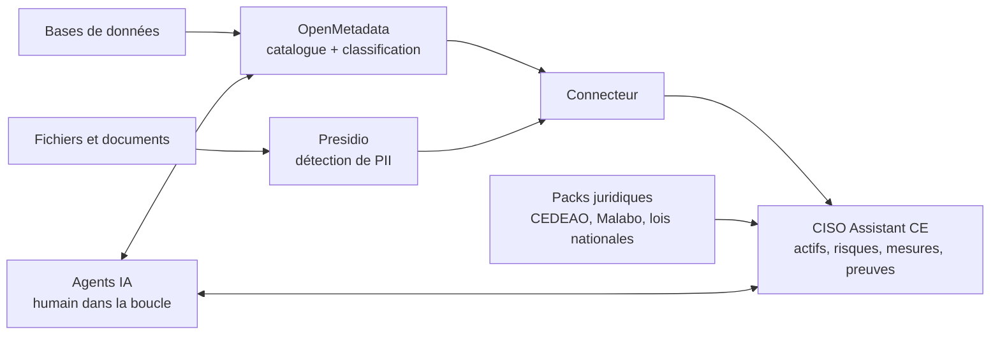

# AfriGRC (nom de travail)

**Plateforme 100 % open source et souveraine de gouvernance des données et de conformité, conçue pour le cadre juridique ouest-africain.**

🇬🇧 [Read in English](README.md)

> 🚧 **Statut du projet : stade précoce (concept et architecture).**
> Il n'existe pas encore de prototype fonctionnel. Ce dépôt documente la vision, l'architecture et la feuille de route. Une preuve de concept est la prochaine étape (voir [Feuille de route](#feuille-de-route)).

---

## Le problème

Les PME, administrations et écoles d'Afrique de l'Ouest doivent protéger les données personnelles et gérer leurs risques cyber. Elles sont soumises à des lois nationales (loi sénégalaise sur les données personnelles, loi ivoirienne, Nigeria Data Protection Act, loi ghanéenne, etc.), à l'Acte additionnel A/SA.1/01/10 de la CEDEAO et, de plus en plus, à la Convention de Malabo de l'Union africaine.

Pourtant, les outils qui rendent cela réalisable sont hors de portée :

- Les suites de gouvernance des données et plateformes GRC commerciales coûtent cher et sont souvent liées à un écosystème propriétaire.
- Elles sont conçues autour de référentiels européens ou américains, rarement autour des lois, des langues, des identifiants et des budgets de la région.
- Les référentiels ouest-africains sont dispersés : chaque pays a son texte, son autorité et son calendrier, alors que beaucoup d'organisations opèrent dans plusieurs pays.

Résultat : la conformité se fait à la main, par des missions de conseil longues et coûteuses, ou ne se fait pas.

## La solution

AfriGRC assemble des briques open source matures en une plateforme qui tourne sur l'infrastructure du client, sans dépendance à un éditeur :

| Couche | Composant | Rôle |
|---|---|---|
| Gouvernance, risques et conformité | [CISO Assistant](https://github.com/intuitem/ciso-assistant-community) (Community Edition) | Actifs, risques, mesures, preuves, audits, référentiels de conformité |
| Découverte et classification des données | [OpenMetadata](https://open-metadata.org/) | Catalogue de données, lineage, détection et étiquetage automatiques des données personnelles (PII) sur les données structurées |
| Analyse des données non structurées | [Microsoft Presidio](https://github.com/microsoft/presidio) (projet open source) | Détection de PII dans les documents et textes, étendue avec des reconnaisseurs français, anglais et locaux |
| Intégration | Connecteur maison (ce dépôt) | Transforme les résultats de découverte en actifs, risques et preuves dans CISO Assistant |
| Intelligence | Agents IA encadrés (ce dépôt) | Automatisent les tâches répétitives et coûteuses d'une mission de conformité |

## Cadre juridique ciblé

Le cœur de la valeur d'AfriGRC est un ensemble de **« packs juridiques »** : des référentiels personnalisés CISO Assistant, un par texte, que l'on peut combiner pour une organisation multi-pays. Une même évaluation peut être confrontée à plusieurs référentiels à la fois.

| Niveau | Textes visés |
|---|---|
| Régional | Acte additionnel A/SA.1/01/10 de la CEDEAO sur la protection des données personnelles (en cours de révision) ; Acte additionnel A/SA.2/01/10 sur les transactions électroniques ; Directive 1/08/11 sur la cybercriminalité |
| Continental | Convention de Malabo de l'Union africaine (entrée en vigueur le 8 juin 2023) |
| National, priorité 1 | Sénégal : loi n° 2008-12 sur la protection des données à caractère personnel |
| National, priorité 2 | Côte d'Ivoire (loi n° 2013-450), Nigeria (Nigeria Data Protection Act 2023 et GAID), Ghana (Data Protection Act 2012) |
| National, ensuite | Bénin, Burkina Faso, Mali, Togo, Niger, Guinée et autres |
| Sectoriel | Exigences des régulateurs bancaires et télécoms, à cartographier au cas par cas |
| Standards internationaux | ISO 27001, NIST CSF, NIST AI RMF, déjà fournis par CISO Assistant, pour la compatibilité avec les clients internationaux |

> ⚠️ Les références juridiques de ce tableau sont à **valider par un juriste** pendant la Phase 3, car les textes évoluent (par exemple la révision de l'Acte additionnel de la CEDEAO).

## Fonctionnalités prévues

- Découverte et classification automatiques des données personnelles et sensibles
- Cartographie des données et registre des traitements générés à partir du catalogue
- Packs juridiques ouest-africains, combinables pour une organisation présente dans plusieurs pays
- Détection d'identifiants locaux : CNI et NINEA (Sénégal), NIN (Nigeria), Ghana Card, numéros de mobile money, IBAN UEMOA
- Interface et contenus en français et en anglais, pour couvrir l'Afrique de l'Ouest francophone et anglophone
- Préparation d'audit, rédaction de preuves et recommandations assistées par IA
- Suivi des écarts

## Architecture

## Des agents IA encadrés

Les agents sont conçus pour assister le consultant ou le responsable conformité, jamais pour le remplacer. Agents prévus :

1. **Cartographe** : construit la cartographie des données et le registre des traitements à partir du catalogue.
2. **Préparateur d'audit** : pré-remplit les évaluations de conformité.
3. **Rédacteur de preuves et recommandations** : rédige les preuves et les conseils de remédiation.
4. **Suiveur d'écarts** : détecte les dérives et relance les points ouverts.

Garde-fous :

- Accès en lecture seule aux sources de données du client
- Validation humaine avant toute écriture dans CISO Assistant
- Journal d'audit complet de chaque action des agents
- Le modèle de langage reçoit **uniquement des métadonnées**, jamais les données brutes
- Modèle interchangeable, avec une option entièrement locale (modèles à poids ouverts) pour la souveraineté

## Pourquoi cette approche

- **Souveraineté** : aucune dépendance à un tenant ou à un éditeur ; les données restent sur l'infrastructure du client.
- **Coût réduit** : tout repose sur des composants open source, sans licence à acheter.
- **Mises à jour héritées** : les améliorations des projets sous-jacents profitent à la plateforme.
- **Ancrage régional** : des référentiels pensés pour l'espace CEDEAO, pas adaptés après coup d'un cadre européen.
- **Réutilisable** : un pack juridique créé pour un pays profite à toutes les organisations de ce pays.

## Feuille de route

- [x] **Phase 0** : Architecture et positionnement
- [ ] **Phase 1** : Preuve de concept locale. Déployer CISO Assistant CE et OpenMetadata avec Docker ; jeu de données fictif d'une PME sénégalaise ; classification automatique
- [ ] **Phase 2** : Connecteur. Synchroniser les actifs classifiés vers CISO Assistant (actifs, scénarios de risque, mesures appliquées, preuves)
- [ ] **Phase 3** : Packs juridiques et reconnaisseurs locaux. Sénégal en premier, puis Côte d'Ivoire, Nigeria, Ghana, Acte additionnel CEDEAO et Convention de Malabo ; reconnaisseurs de PII français, anglais et locaux
- [ ] **Phase 4** : Premier agent IA (cartographe) avec validation humaine
- [ ] **Phase 5** : Pilotes avec des PME, administrations ou écoles

## Notes techniques et limites

- OpenMetadata est plus lourd à exploiter que CISO Assistant (base de données, moteur de recherche, ingestion). Le dimensionnement pour les petites organisations sera validé pendant la Phase 1.
- CISO Assistant Community Edition est sous licence AGPL-3.0. Ce dépôt est lui aussi sous AGPL-3.0 ; le connecteur interagira avec CISO Assistant via son API pour garder une séparation nette.
- Les licences et versions des composants tiers doivent être revérifiées au moment de l'intégration.
- Les textes juridiques évoluent ; chaque pack indiquera la version du texte couverte.
- Ce projet fournit des outils. Il ne constitue **pas un avis juridique**, et son usage ne garantit pas à lui seul la conformité.

## Contribuer

Le projet en est à un stade très précoce. Les retours de DPO, de praticiens de la sécurité, de juristes et de PME d'Afrique de l'Ouest sont particulièrement bienvenus, notamment pour relire les packs juridiques de leur pays. Ouvrez une issue pour discuter d'idées, ou contactez-nous directement.

## Licence

[GNU Affero General Public License v3.0 (AGPL-3.0)](LICENSE). Choix de protection : toute version modifiée de ce projet proposée comme service en ligne doit rester ouverte, comme CISO Assistant Community Edition.

## Contact

*[Uk'iva DAPAM, DUKSTON, https://www.linkedin.com/in/ukivadapam-cybersecurity/]*
