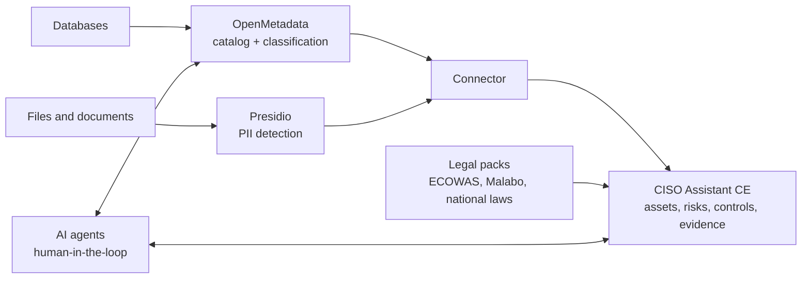

# AfriGRC (working title)

**A 100% open-source, sovereign data governance and compliance platform built for the West African legal framework.**

🇫🇷 [Lire en français](README.fr.md)

> 🚧 **Project status: early stage (concept and architecture).**
> There is no working prototype yet. This repository documents the vision, the architecture and the roadmap. A proof of concept is the next milestone (see [Roadmap](#roadmap)).

---

## The problem

SMEs, public administrations and schools in West Africa must protect personal data and manage their cyber risks. They are bound by national laws (Senegal's personal data protection law, Côte d'Ivoire's law, Nigeria's Data Protection Act, Ghana's Data Protection Act, and others), by the ECOWAS Supplementary Act A/SA.1/01/10 and, increasingly, by the African Union's Malabo Convention.

Yet the tools that make this manageable are out of reach:

- Commercial data governance suites and GRC platforms are expensive and often tied to a proprietary ecosystem.
- They are built around European or US frameworks, rarely around the laws, languages, identifiers and budgets of the region.
- West African frameworks are fragmented: each country has its own text, authority and timeline, while many organisations operate in several countries.

As a result, compliance is done manually through costly, slow consulting missions, or not done at all.

## The solution

AfriGRC combines mature open-source building blocks into one platform that runs on the client's own infrastructure, with no vendor dependency:

| Layer | Component | Role |
|---|---|---|
| Governance, risk and compliance | [CISO Assistant](https://github.com/intuitem/ciso-assistant-community) (Community Edition) | Assets, risks, controls, evidence, audits, compliance frameworks |
| Data discovery and classification | [OpenMetadata](https://open-metadata.org/) | Data catalog, lineage, automatic PII detection and tagging on structured data |
| Unstructured data scanning | [Microsoft Presidio](https://github.com/microsoft/presidio) (open-source project) | PII detection in documents and text, extended with French, English and local recognizers |
| Integration | Custom connector (this repo) | Turns discovery results into assets, risks and evidence in CISO Assistant |
| Intelligence | Supervised AI agents (this repo) | Automate the costly, repetitive parts of a compliance mission |

## Targeted legal framework

The core value of AfriGRC is a set of **"legal packs"**: custom CISO Assistant frameworks, one per text, that can be combined for a multi-country organisation. A single assessment can be run against several frameworks at once.

| Level | Targeted texts |
|---|---|
| Regional | ECOWAS Supplementary Act A/SA.1/01/10 on personal data protection (under revision); Supplementary Act A/SA.2/01/10 on electronic transactions; Directive 1/08/11 on cybercrime |
| Continental | African Union Malabo Convention (in force since 8 June 2023) |
| National, priority 1 | Senegal: Law No. 2008-12 on personal data protection |
| National, priority 2 | Côte d'Ivoire (Law No. 2013-450), Nigeria (Nigeria Data Protection Act 2023 and GAID), Ghana (Data Protection Act 2012) |
| National, next | Benin, Burkina Faso, Mali, Togo, Niger, Guinea and others |
| Sectoral | Banking and telecom regulator requirements, to be mapped case by case |
| International standards | ISO 27001, NIST CSF, NIST AI RMF, already provided by CISO Assistant, for compatibility with international clients |

> ⚠️ The legal references in this table must be **validated by a lawyer** during Phase 3, as the texts evolve (for example the revision of the ECOWAS Supplementary Act).

## Planned features

- Automatic discovery and classification of personal and sensitive data
- Data mapping and processing register generated from the catalog
- West African legal packs, combinable for organisations present in several countries
- Detection of local identifiers: national ID and NINEA (Senegal), NIN (Nigeria), Ghana Card, mobile money numbers, UEMOA IBAN
- French and English interface and content, covering francophone and anglophone West Africa
- AI-assisted audit preparation, evidence drafting and recommendations
- Gap tracking and follow-up

## Architecture

## AI agents, under control

Agents are designed to assist the consultant or compliance officer, never to replace them. Planned agents:

1. **Mapper**: builds the data map and processing register from the catalog.
2. **Audit preparer**: pre-fills compliance assessments.
3. **Evidence and recommendations writer**: drafts evidence and remediation advice.
4. **Gap tracker**: detects drift and follows up on open items.

Guardrails:

- Read-only access to client data sources
- Human validation before any write to CISO Assistant
- Full audit log of every agent action
- The language model receives **metadata only**, never raw data
- Interchangeable model backend, including a fully local option (open-weight models) for sovereignty

## Why this approach

- **Sovereignty**: no dependency on a vendor tenant; data stays on the client's infrastructure.
- **Low cost**: everything is built on open-source components, with no licence to buy.
- **Upstream updates**: improvements to the underlying projects are inherited.
- **Regional anchoring**: frameworks designed for the ECOWAS area, not retrofitted from a European model.
- **Reusable**: a legal pack built for one country benefits every organisation in that country.

## Roadmap

- [x] **Phase 0**: Architecture and positioning
- [ ] **Phase 1**: Local proof of concept. Deploy CISO Assistant CE and OpenMetadata with Docker; synthetic dataset of a fictional Senegalese SME; automatic classification
- [ ] **Phase 2**: Connector. Sync classified assets into CISO Assistant (assets, risk scenarios, applied controls, evidence)
- [ ] **Phase 3**: Legal packs and local recognizers. Senegal first, then Côte d'Ivoire, Nigeria, Ghana, the ECOWAS Supplementary Act and the Malabo Convention; French, English and local PII recognizers
- [ ] **Phase 4**: First AI agent (mapper) with human validation
- [ ] **Phase 5**: Pilots with SMEs, administrations or schools

## Technical notes and limitations

- OpenMetadata is heavier to run than CISO Assistant (database, search engine, ingestion). Sizing for small organisations will be validated during Phase 1.
- CISO Assistant Community Edition is licensed under AGPL-3.0. This repository is also licensed under AGPL-3.0; the connector will interact with CISO Assistant through its API to keep a clean separation.
- Licenses and versions of third-party components must be re-verified at integration time.
- Legal texts evolve; each pack will state the version of the text it covers.
- This project provides tooling. It is **not legal advice**, and using it does not by itself guarantee compliance.

## Contributing

The project is at a very early stage. Feedback from DPOs, security practitioners, legal experts and SMEs in West Africa is especially welcome, in particular to review the legal packs of their country. Open an issue to discuss ideas, or reach out directly.

## License

[GNU Affero General Public License v3.0 (AGPL-3.0)](LICENSE). A protective choice: any modified version of this project offered as an online service must remain open, like CISO Assistant Community Edition.

## Contact

*[Uk'iva DAPAM, DUKSTON, https://www.linkedin.com/in/ukivadapam-cybersecurity/]*
