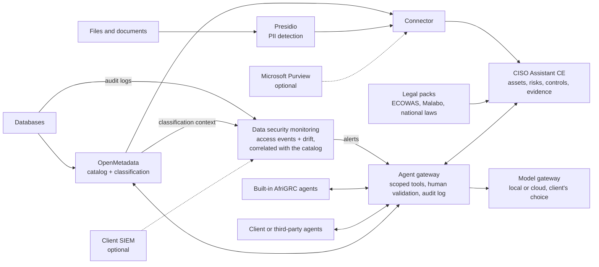

# AfriGRC (working title)

**A 100% open-source, sovereign data security and GRC (governance, risk and compliance) platform built for the West African legal framework, with supervised and swappable AI agents.**

🇫🇷 [Lire en français](README.fr.md)

> 🚧 **Project status: early stage (concept, architecture, first building blocks).**
> There is no working prototype of the platform yet. What exists today: the vision, the architecture, the roadmap, a synthetic dataset generator and an audited demo database for the proof of concept (see [`data/synthetic`](data/synthetic) and [`deploy`](deploy)). The local proof of concept is the current milestone (see [Roadmap](#roadmap)).

---

## The problem

SMEs, public administrations and schools in West Africa must protect personal data and manage their cyber risks. They are bound by national laws (Senegal's personal data protection law, Côte d'Ivoire's law, Nigeria's Data Protection Act, Ghana's Data Protection Act, and others), by the ECOWAS Supplementary Act A/SA.1/01/10 and, increasingly, by the African Union's Malabo Convention.

Yet the tools that make this manageable are out of reach:

- Commercial data governance suites and GRC platforms (such as Microsoft Purview) are expensive, often tied to a proprietary ecosystem, and assume a specific vendor tenant.
- They are built around European or US frameworks, rarely around the laws, languages, identifiers and budgets of the region.
- West African frameworks are fragmented: each country has its own text, authority and timeline, while many organisations operate in several countries.

As a result, compliance is done manually through costly, slow consulting missions, or not done at all.

## The solution

AfriGRC is centred on two priorities: **GRC** (assets, risks, controls, evidence, audits against local laws) and **data security** (knowing where sensitive data is, who touches it, and when something drifts). It combines mature open-source building blocks into one platform that runs on the client's own infrastructure, with no vendor dependency. It works standalone, and can optionally be coupled to Microsoft Purview or to the client's own SIEM.

| Layer | Component | Role |
|---|---|---|
| Governance, risk and compliance | [CISO Assistant](https://github.com/intuitem/ciso-assistant-community) (Community Edition) | Assets, risks, controls, evidence, audits, compliance frameworks |
| Data discovery and classification | [OpenMetadata](https://open-metadata.org/) | Data catalog, lineage, automatic PII detection and tagging on structured data |
| Unstructured data scanning | [Microsoft Presidio](https://github.com/microsoft/presidio) (open-source project) | PII detection in documents and text, extended with French, English and local recognizers |
| Data security monitoring | Custom module (this repo) fed by native database audit logs (for example pgaudit for PostgreSQL) | Detects access to sensitive data and classification drift, and links each event to the catalog and to legal obligations |
| Integration | Custom connector (this repo) | Turns discovery results into assets, risks and evidence in CISO Assistant |
| Agent gateway | Custom service (this repo) | Single, controlled entry point for all AI agents: scoped tools, human validation, audit log |
| Model gateway | Model-agnostic proxy such as [LiteLLM](https://github.com/BerriAI/litellm) (to be validated) | Lets the client pick local or cloud language models through one interface |
| Intelligence | Supervised AI agents (this repo) and client-supplied agents | Automate the costly, repetitive parts of a compliance mission |
| Optional integrations | Microsoft Purview; the client's own SIEM (for example Wazuh) | Import Purview classification results; receive infrastructure alerts from an existing SIEM |

## Targeted legal framework

The core value of AfriGRC is a set of **"legal packs"**: custom CISO Assistant frameworks, one per text, that can be combined for a multi-country organisation. A single assessment can be run against several frameworks at once.

| Level | Targeted texts |
|---|---|
| Regional | ECOWAS Supplementary Act A/SA.1/01/10 on personal data protection (under revision); Supplementary Act A/SA.2/01/10 on electronic transactions; Directive 1/08/11 on cybercrime |
| Continental | African Union Malabo Convention (in force since 8 June 2023) |
| National, priority 1 | Senegal: Law No. 2008-12 on personal data protection |
| National, priority 2 | Côte d'Ivoire (Law No. 2013-450), Nigeria (Nigeria Data Protection Act 2023 and GAID), Ghana (Data Protection Act 2012) |
| National, next | Benin, Burkina Faso, Mali, Togo, Niger, Guinea and others |
| Sectoral | Banking and telecom regulator requirements, to be mapped case by case |
| International standards | ISO 27001, NIST CSF, NIST AI RMF, already provided by CISO Assistant, for compatibility with international clients |

> ⚠️ The legal references in this table must be **validated by a lawyer** during Phase 3, as the texts evolve (for example the revision of the ECOWAS Supplementary Act).

## Planned features

**GRC**
- West African legal packs, combinable for organisations present in several countries
- Data mapping and processing register generated from the catalog
- AI-generated periodic and on-demand audits against the selected legal packs
- Gap tracking and follow-up
- French and English interface and content, covering francophone and anglophone West Africa

**Data security**
- Automatic discovery and classification of personal and sensitive data
- Detection of local identifiers: national ID and NINEA (Senegal), NIN (Nigeria), Ghana Card, mobile money numbers, UEMOA IBAN
- Data security monitoring: alerts when sensitive data is accessed or moved abnormally, and when new sensitive data appears unclassified, each linked to the asset, the legal obligation and the risk
- AI-proposed security rules to better protect sensitive data

**Openness**
- Selectable agents: use the built-in agents, bring your own, or plug in third-party agents
- Optional coupling with Microsoft Purview and with the client's SIEM

## Architecture



## AI agents, under control

Agents are designed to assist the consultant or compliance officer, never to replace them.

Planned built-in agents:

1. **Mapper**: builds the data map and processing register from the catalog.
2. **Auditor**: pre-fills compliance assessments and generates periodic or on-demand audits against the selected legal packs.
3. **Evidence and recommendations writer**: drafts evidence and remediation advice.
4. **Gap tracker**: detects drift and follows up on open items.
5. **Rules advisor**: proposes security rules (for example encryption of a sensitive column, access restriction, retention period) based on the catalog and the gaps found.
6. **Data alert analyst**: explains alerts from the data security monitoring, linking them to the affected assets, the personal data involved and the relevant legal obligations, and proposes a response.
7. **Watcher**: monitors updates and security advisories of the underlying components and alerts the maintainers (see [Maintenance](#maintenance-and-updates)).

### Bring your own agents

Every agent, built-in or not, reaches the platform only through the **agent gateway**, which exposes a limited set of tools (for example "read catalog metadata", "propose a finding", "propose a rule"). The gateway is designed around open protocols such as MCP (Model Context Protocol), to be validated at integration time. An agent that speaks such a protocol can be plugged in without changing the platform, and the same guardrails apply to all of them.

### Guardrails

- Read-only access to client data sources
- Human validation before any write to CISO Assistant
- Full audit log of every agent action
- The language model receives **metadata only**, never raw data
- Interchangeable model backend through the model gateway, including a fully local option (open-weight models) for sovereignty
- AI output is a proposal, not a verdict: findings cite their sources so they can be verified

## Why this approach

- **Sovereignty**: no dependency on a vendor tenant; data stays on the client's infrastructure.
- **Low cost**: everything is built on open-source components, with no licence to buy.
- **Upstream evolution**: the platform benefits from the improvements of the underlying open-source projects, within a controlled update process.
- **Regional anchoring**: frameworks designed for the ECOWAS area, not retrofitted from a European model.
- **Data-centred correlation**: events are linked to classified data, legal obligations and risks, which generic monitoring tools do not do.
- **Freedom of choice**: swappable agents and language models, local or cloud.
- **Reusable**: a legal pack built for one country benefits every organisation in that country.

## Maintenance and updates

Updates of the underlying projects are not automatic, and the connector, monitoring module, gateways, agents, recognizers and legal packs are maintained here. The goal is a controlled, low-effort process:

- Pinned component versions, never `latest`
- Automated update proposals (Renovate or Dependabot)
- Automated end-to-end tests (GitHub Actions) that run the stack on the synthetic dataset before any update is merged
- The connector talks only to the public APIs of the components
- Security updates handled separately from functional ones
- The Watcher agent summarises release notes and advisories, estimates the impact on this project and alerts the maintainers; it never changes anything by itself
- Legal packs are never updated automatically: each pack states the version of the text it covers and requires legal review

## Repository structure (target)

```
AfriGRC/
├── deploy/            # docker-compose files, demo database, installation scripts
├── data/synthetic/    # synthetic Senegalese SME data generator and demo scenarios
├── connector/         # OpenMetadata -> CISO Assistant (Phase 2)
├── recognizers/       # local Presidio recognizers (Phase 3)
├── frameworks/        # legal packs (CISO Assistant YAML/Excel)
├── gateway/           # agent gateway and model gateway (Phase 4)
├── agents/            # built-in agents
├── monitoring/        # data security monitoring module (Phase 6)
└── docs/
```

## Roadmap

- [x] **Phase 0**: Architecture and positioning
- [ ] **Phase 1** (in progress): Local proof of concept. Deploy CISO Assistant CE and OpenMetadata with Docker; synthetic dataset of a fictional Senegalese SME and audited demo database (both available); automatic classification
- [ ] **Phase 2**: Connector and maintenance foundations. Sync classified assets into CISO Assistant (assets, risk scenarios, applied controls, evidence); pinned versions, automated update proposals and end-to-end tests
- [ ] **Phase 3**: Legal packs and local recognizers. Senegal first, then Côte d'Ivoire, Nigeria, Ghana, the ECOWAS Supplementary Act and the Malabo Convention; French, English and local PII recognizers
- [ ] **Phase 4**: Agent gateway, model gateway and first agents (mapper, watcher), with human validation
- [ ] **Phase 5**: Auditor and rules advisor agents; periodic audit generation
- [ ] **Phase 6**: Data security monitoring. Database audit logs, correlation with the catalog, classification drift detection and data alert analyst agent (PostgreSQL first)
- [ ] **Phase 7**: Optional integrations with Microsoft Purview and the client's SIEM
- [ ] **Phase 8**: Pilots with SMEs, administrations or schools

## Technical notes and limitations

- OpenMetadata is heavier to run than CISO Assistant (database, search engine, ingestion). Sizing for small organisations will be validated during Phase 1.
- OpenMetadata's built-in classifier does not know local identifiers (national ID, NINEA, UEMOA IBAN, and so on); this is what the local recognizers of Phase 3 are for.
- Data security monitoring covers targeted use cases (access to sensitive data, classification drift) and is **not** a full equivalent of commercial DLP or DSPM suites. Detection depends on the audit logs of each database engine, starts with PostgreSQL, and is near real time at best; drift detection relies on periodic scans. Audit logging adds load and storage that must be sized.
- Endpoint and infrastructure monitoring (malware, intrusion) is out of scope; clients can feed alerts from their own SIEM.
- CISO Assistant Community Edition is licensed under AGPL-3.0. This repository is also licensed under AGPL-3.0; the connector will interact with CISO Assistant through its API to keep a clean separation.
- Licenses and versions of third-party components must be re-verified at integration time.
- Legal texts evolve; each pack will state the version of the text it covers.
- AI agents can make mistakes. Their output must be reviewed by a qualified person.
- This project provides tooling. It is **not legal advice**, and using it does not by itself guarantee compliance.

## Contributing

The project is at a very early stage. Feedback from DPOs, security practitioners, legal experts and SMEs in West Africa is especially welcome, in particular to review the legal packs of their country. Open an issue to discuss ideas, or reach out directly.

## License

[GNU Affero General Public License v3.0 (AGPL-3.0)](LICENSE). A protective choice: any modified version of this project offered as an online service must remain open, like CISO Assistant Community Edition.

## Contact

*[Uk'iva DAPAM, DUKSTON, https://www.linkedin.com/in/ukivadapam-cybersecurity/]*
